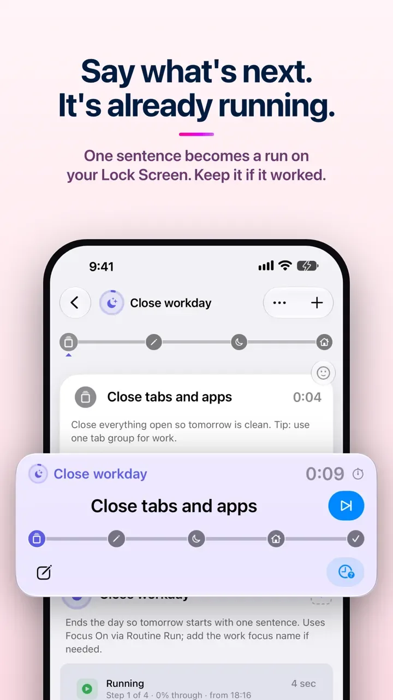

# See it

What Routine Run does, each in under a minute, filmed on a real phone and watch.

## A page starts the runbook

PagerDuty sends an alert. The routine "When something pages you" starts by itself, and its
first step is on the Lock Screen before the phone is unlocked; Next moves it on from the card.

https://github.com/user-attachments/assets/38cc2d2a-36fd-457d-b4be-8260b4d5f15b

Needs iOS 27, PagerDuty's app, and the shortcut from [connections/pagerduty.json](../connections/pagerduty.json).
How to set it up: [routinerun.com/help/on-call](https://routinerun.com/help/on-call).

## Describe it, it writes the routine

One sentence — "help me close the workday so tomorrow starts with one sentence" — becomes a
routine, and the routine is already running, with its card on the Lock Screen. Keep it if it worked.

Written by Apple's cloud on iOS 27, the phone's own model, or the assistant you already use.
How: [routinerun.com/help/describe-it](https://routinerun.com/help/describe-it).

## A tap on the watch runs a shortcut in the background

Next tapped on the watch reaches the step "Turn a Focus on". The step runs its shortcut by
itself, in the background — the phone stays locked and nobody touches it — and the Focus comes
on, with its own wallpaper. The step did the work; the tap on the wrist only said "next".

https://github.com/user-attachments/assets/9aa4f288-3e6e-4ea7-ba69-c3baca38e582

The shortcut is [Focus On via Routine Run](../shortcuts/ours/focus-on.json); a step runs it
in the background through the Routine Run bridge ([how](https://routinerun.com/help/in-the-background)).
How the watch works: [routinerun.com/help/the-watch-app](https://routinerun.com/help/the-watch-app).
